# aysh

<p align="center">
  
</p>

Лёгкая командная оболочка на Rust без сети и телеметрии. Конфигурация оболочки задаётся в TOML.

## Сборка и запуск

Требуется установленный Rust (Cargo).

```sh
cargo build --release
./target/release/aysh
```

Профиль release включает LTO, один codegen unit, удаление символов отладки и `panic = "abort"`, чтобы уменьшить бинарник.

## Возможности

- запуск программ из `PATH`;
- простые и двойные кавычки, экранирование обратной косой чертой;
- подстановка `$NAME`, `${NAME}` и `$?`;
- конвейеры `|`;
- перенаправление `<`, `>` и `>>`;
- встроенные команды `cd`, `pwd`, `export`, `unset`, `help` и `exit`.

Встроенные команды доступны как отдельные команды (не внутри конвейера). Это намеренно компактная оболочка, а не полная реализация POSIX shell: нет подстановок команд, globbing, фоновых задач, условных конструкций и скриптовых функций.

## Конфигурация

Файл конфигурации: `$XDG_CONFIG_HOME/aysh/config.toml`, либо `~/.config/aysh/config.toml`, если `XDG_CONFIG_HOME` не задан. Если файл отсутствует, приглашение по умолчанию — `# `.

```toml
prompt = "aysh> "
autostart = ["echo Welcome to aysh", "pwd"]

[style]
bold = true
italic = false
color = "cyan" # black, red или cyan (голубой)
```

`autostart` может быть одной строкой или массивом строк. Команды запускаются последовательно при старте оболочки и поддерживают тот же синтаксис, что и обычный ввод. Параметры `style` оформляют приглашение и вывод встроенных команд. Цвета используют ANSI: чёрный, красный или голубой (cyan). Форматирование также можно задать отдельно для `echo`: `echo --bold --italic --color red текст`. ANSI-форматирование применяется только при интерактивном выводе в терминал.

При ошибке чтения или разбора конфигурации оболочка сообщает об ошибке в stderr и запускается с настройками по умолчанию. TOML разбирается библиотекой `toml`.

## Память и приватность

В оболочке нет телеметрии, сетевых вызовов или фоновых служб. Потребление памяти зависит от ОС и окружения; память дочерних программ в него не входит.

## Тесты

```sh
cargo test
```
